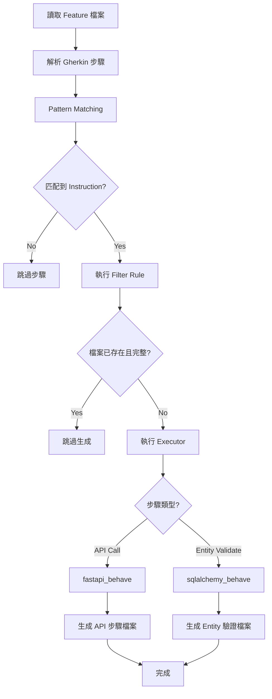

> **DEPRECATED**: 本文件引用了已移除的 sdd.os Python codegen 框架（PR #180）。
> 所有 `pip install`、`pyproject.toml`、`src/sdd_os/` 相關路徑已不存在。本文件保留作為歷史參考。

# Python Benchmark CodeGen 使用指南

本指南專注於說明如何使用 **CodeGen 自動化工具**，從 Gherkin feature 檔案生成 Behave 測試步驟定義。

> 💡 **專案概覽與測試執行**，請參閱 **[README.md](README.md)**

---

## 📋 目錄

- [系統需求](#系統需求)
- [環境設置](#環境設置)
- [執行 CodeGen](#執行-codegen)
- [生成檔案說明](#生成檔案說明)
- [驗證生成結果](#驗證生成結果)
- [常見問題排除](#常見問題排除)
- [進階使用](#進階使用)
- [CodeGen 工作流程](#codegen-工作流程)

---

## 系統需求

- **Python**: >= 3.10
- **pip**: Python 套件管理工具
- **作業系統**: macOS / Linux / Windows

---

## 環境設置

### 步驟 1：建立虛擬環境

從專案根目錄執行：

```bash
cd /path/to/sdd.os

# 建立虛擬環境
python -m venv .venv

# 啟用虛擬環境
# macOS / Linux
source .venv/bin/activate

# Windows
.venv\Scripts\activate
```

### 步驟 2：安裝專案相依套件

```bash
# 安裝核心相依套件
pip install -e .

# 安裝 dev 相依套件（包含 behave）
pip install -e ".[dev]"

# 安裝 benchmark-python 相依套件
pip install -e ".[benchmark-python]"
```

**安裝的相依套件包括**：

**核心相依套件**：
- `claude-agent-sdk` - AI 代碼生成支援
- `gherkin-official` - Gherkin 解析器
- `PyYAML` - YAML 組態解析
- `Jinja2` - 樣板引擎
- `omegaconf` - 組態管理

**dev 可選相依套件**：
- `pytest` - 測試框架
- `behave ~= 1.3.3` - BDD 測試框架（完整支援 Scenario Outline + datatable）

**benchmark-python 可選相依套件**：
- `fastapi[standard] ~= 0.115.0` - FastAPI 框架（包含 uvicorn、pydantic、httpx）
- `sqlalchemy ~= 2.0.23` - ORM
- `python-jsonpath ~= 2.0.1` - JSONPath 回應驗證

### 步驟 3：驗證安裝

```bash
# 檢查 Python 版本
python --version  # 應顯示 3.10 或更高

# 檢查關鍵套件
python -c "import behave; import fastapi; import sqlalchemy; import jsonpath; print('✓ 所有相依套件已安裝')"
```

**注意**：確保虛擬環境已啟用（命令提示符前會顯示 `(.venv)`）

---

## 執行 CodeGen

### 基本用法

從 `benchmark/guessing_game/python` 目錄執行：

```bash
# 確保虛擬環境已啟用
source ../../../.venv/bin/activate

# 執行 CodeGen
bash assembler_codegen.sh
```

### 帶 DEBUG 日誌執行

查看詳細的生成過程：

```bash
bash assembler_codegen.sh --log-level DEBUG
```

### 自訂 Feature 路徑

```bash
bash assembler_codegen.sh --feature src/test/features
```

---

## 生成檔案說明

### 生成的檔案結構

執行 CodeGen 後，將生成以下檔案：

```
src/test/features/steps/
├── api/                              # API 呼叫步驟
│   ├── API_玩家加入遊戲.py
│   ├── API_玩家設定秘密.py
│   └── API_玩家猜測數字.py
└── then/                             # 實體驗證步驟
    ├── Then_存在一個遊戲_With_Table.py
    └── Then_存在一個玩家_With_Table.py
```

### 檔案類型說明

#### 1. API 呼叫步驟（`src/test/features/steps/api/`）

**生成條件**：
- Feature 檔案中包含 `<summary>, call table:` 格式的步驟
- OpenAPI spec (`spec/api/api.yml`) 中存在對應的 `summary`

**生成內容**：
- 使用 `@given` + `@when` 雙裝飾器（確保 Given/When 步驟均可使用）
- 函式名稱：固定為 `invoke`（遵循 Screaming Architecture）
- 參數：`context`（Behave context 物件）
- 功能：呼叫 FastAPI endpoint，將 response 存入 `context.last_response`

**範例**：
```python
@given("玩家加入遊戲, call table:")
@when("玩家加入遊戲, call table:")
def invoke(context):
    """
    Step: 玩家加入遊戲, call table:
    
    Calls API endpoint: POST /games
    """
    rows = [dict(zip(row.headings, row.cells)) for row in context.table]
    row = rows[0]
    
    request_body = {
        "gameId": row["gameId"],
        "playerName": row["playerName"]
    }
    response = context.client.post("/games", json=request_body)
    context.last_response = response
```

**支援的功能**：
- ✅ GET 請求：路徑參數替換（`.format()`）+ query parameters
- ✅ POST/PUT/PATCH：JSON request body
- ✅ 巢狀欄位：`result.a` → `{"result": {"a": 2}}`
- ✅ 陣列索引：`items[0].quantity` → `{"items": [{"quantity": 3}]}`
- ✅ 自動型別轉換：string → int/bool/float

#### 2. 實體驗證步驟（`src/test/features/steps/then/`）

**生成條件**：
- Feature 檔案中包含 `存在一個<實體>, with table:` 格式的步驟
- Entity spec (`spec/entities/<實體>.yml`) 存在

**生成內容**：
- 使用 `@then` 裝飾器
- 函式名稱：固定為 `validate`
- 參數：`context`（Behave context 物件）
- 功能：查詢資料庫實體並驗證欄位值
- **自動轉換**：camelCase (spec) → snake_case (Python model)

**範例**：
```python
@then("存在一個遊戲, with table:")
def validate(context):
    """
    Validate that Game entity (or entities) exist with expected values.
    """
    from app.main.models import Game
    
    rows = [dict(zip(context.table.headings, row.cells)) for row in context.table]
    
    for row in rows:
        game_id = row["id"]
        entity = context.db_session.query(Game).filter_by(id=game_id).first()
        
        assert entity is not None, f"Game with id={game_id} should exist"
        
        # camelCase → snake_case 自動轉換
        if "winnerId" in row:
            assert entity.winner_id == row["winnerId"]
```

---

## 驗證生成結果

### 檢查檔案是否生成

```bash
# 檢查 API 步驟
ls -la src/test/features/steps/api/

# 檢查實體驗證步驟
ls -la src/test/features/steps/then/
```

**預期輸出**：
- 3 個 API 呼叫步驟檔案
- 2 個實體驗證步驟檔案

### 驗證語法正確性

```bash
# 編譯檢查所有生成的檔案
python3 -m py_compile src/test/features/steps/api/*.py src/test/features/steps/then/*.py

# 無輸出表示語法正確
echo "✓ 所有檔案語法正確"
```

### 驗證可匯入性

```bash
python -c "
import sys
sys.path.insert(0, 'src')

# 測試匯入
from test.steps.api.API_玩家加入遊戲 import invoke
from test.steps.then.Then_存在一個遊戲_With_Table import validate

print('✓ 所有步驟定義可成功匯入')
"
```

---

## 常見問題排除

### 問題 1：`ModuleNotFoundError: No module named 'features'`

**原因**：未啟用虛擬環境或 PYTHONPATH 未設定

**解決方案**：
```bash
# 確保從 benchmark/guessing_game/python 目錄執行
cd benchmark/guessing_game/python

# 啟用虛擬環境
source ../../../.venv/bin/activate

# 重新執行
bash assembler_codegen.sh
```

### 問題 2：`No such file or directory: isa_codegen.yml`

**原因**：執行目錄錯誤

**解決方案**：
```bash
# 確保在正確目錄
pwd  # 應顯示 .../benchmark/guessing_game/python

# 檢查 ISA 組態檔案存在
ls -l isa_codegen.yml
```

### 問題 3：生成的檔案為空或不完整

**原因**：可能是 executor 或 template 有問題

**解決方案**：
```bash
# 刪除舊檔案
rm -rf src/test/features/steps/api/ src/test/features/steps/then/

# 用 DEBUG 模式重新生成
bash assembler_codegen.sh --log-level DEBUG

# 查看詳細錯誤訊息
```

### 問題 4：`Instruction filtered out`（所有步驟都被跳過）

**原因**：檔案已存在且完整，filter 正確跳過

**說明**：這是**正常行為**！Filter 會檢查：
- 檔案是否存在
- 檔案是否包含 Behave decorator（@given/@when/@then）

**如需重新生成**：
```bash
# 刪除現有檔案
rm -rf src/test/features/steps/api/ src/test/features/steps/then/

# 重新執行
bash assembler_codegen.sh
```

### 問題 5：匯入錯誤 `ModuleNotFoundError: No module named 'app'`

**原因**：這是**預期行為**，models 尚未實作

**說明**：
- 生成的程式碼會 import `from app.main.models import Game`
- 但 `app.main.models` 尚未建立（需要後續實作）
- 這不影響 CodeGen 的正確性

**驗證方式**：
```bash
# 檢查檔案結構而非執行
cat src/test/features/steps/then/Then_存在一個遊戲_With_Table.py
```

### 問題 6：Behave 環境配置

**說明**：Behave 使用 `environment.py` 設定測試 hooks

**位置**：`src/test/features/environment.py`（Behave 預設查找位置）

**關鍵配置**：
```python
from sqlalchemy.pool import StaticPool

# 使用 StaticPool 確保線程安全
engine = create_engine(
    "sqlite:///:memory:",
    connect_args={"check_same_thread": False},
    poolclass=StaticPool,
    echo=False
)
```

**重要性**：
- FastAPI TestClient 在線程池執行請求
- StaticPool 確保所有線程共享同一個 in-memory 資料庫連接
- 否則 API 寫入的資料無法被驗證步驟讀取

---

## 進階使用

### 清理並重新生成

```bash
# 完整清理
rm -rf src/test/features/steps/api/ src/test/features/steps/then/

# 重新生成（帶 DEBUG 日誌）
bash assembler_codegen.sh --log-level DEBUG
```

### 僅生成特定類型的步驟

修改 `isa_codegen.yml`，註解掉不需要的 instruction：

```yaml
# 僅生成 API 步驟，註解掉 Entity validate
instructions:
  - name: API call
    format: ^(?P<summary>.+?), call table:$
    # ... API instruction config ...

  # - name: Entity validate  # 註解掉
  #   format: ^存在一個(?P<entity>[\u4e00-\u9fffa-zA-Z]+), with table:$
  #   # ...
```

### 查看處理統計

```bash
bash assembler_codegen.sh --log-level INFO | grep -E "(Processed|Removed|filtered)"
```

**輸出範例**：
```
Removed 67 duplicate steps based on instruction_text
Instruction filtered out: 玩家加入遊戲, call table:
Processed 5 instructions in 2 batches
```

### 驗證 Filter Rule

手動測試 filter rule 是否正常運作：

```bash
# 設定 PYTHONPATH
export PYTHONPATH=../../../src

# 測試 filter rule
python3 -c "from features.rules.python.should_process_step import match; print('✓ Filter rule 載入成功')"
```

---

## CodeGen 工作流程

完整的 CodeGen 流程如下：



**關鍵步驟說明**：

1. **讀取 Feature 檔案**：掃描 `src/test/features/*.feature`
2. **Pattern Matching**：使用正規表示式比對步驟文字
3. **Filter Rule**：檢查是否需要生成（檔案不存在或不完整）
4. **Executor 執行**：
   - `fastapi_behave`：處理 API 呼叫步驟
   - `sqlalchemy_behave`：處理實體驗證步驟
5. **檔案生成**：使用 Jinja2 樣板生成 Python 程式碼

---

## 相關檔案參考

### 組態檔案

- **ISA 組態**：[isa_codegen.yml](isa_codegen.yml)
- **專案相依套件**：[../../../pyproject.toml](../../../pyproject.toml)
- **執行腳本**：[assembler_codegen.sh](assembler_codegen.sh)

### 輸入檔案

- **Feature 檔案**：`src/test/features/*.feature`
- **API 規格**：`spec/api/api.yml`
- **Entity 規格**：`spec/entities/*.yml`

### Executor 實作

- **API Executor**：`../../../src/sdd_os/features/executors/python/backend/api_call/codegen/candidates/fastapi_behave/`
- **Entity Executor**：`../../../src/sdd_os/features/executors/python/backend/entity_validate/codegen/candidates/sqlalchemy_behave/`

### Filter Rule

- **Filter 實作**：`../../../src/sdd_os/features/rules/python/should_process_step.py`

---

## 下一步：進入 SDD 流程

完成 CodeGen 後（測試步驟已生成），您可以選擇：

### 選項 A：AI 自動實作（推薦）

使用 SDD 工作流程，讓 Claude SDK 基於測試案例自動實作業務邏輯：

```bash
./sdd.sh
```

**工作流程**：
1. Claude SDK 讀取生成的 Behave 測試步驟
2. 自動實作 FastAPI endpoints、SQLAlchemy models、業務邏輯
3. 執行測試驗證
4. 根據測試報告自動修正，直到通過

> 📘 **這就是 SDD 的核心價值**：CodeGen 確保測試精準（無 AI 幻覺），AI 受測試約束實作業務邏輯

### 選項 B：手動實作（練習）

若想練習手動實作，可參考測試步驟與規格：

```bash
# 查看生成的測試步驟
ls -la src/test/features/steps/api/
ls -la src/test/features/steps/then/

# 執行測試查看需求
PYTHONPATH=src:$PYTHONPATH behave src/test/features/
```

**參考資料**：
- OpenAPI 規格：`spec/api/api.yml`
- 實體規格：`spec/entities/*.yml`
- Java 版本實作：`../java/src/main/java/`

---

## 技術支援

如遇問題，請檢查：

1. **專案概覽**：[README.md](README.md) - 包含測試基礎設施與技術堆疊
2. **執行日誌**：使用 `--log-level DEBUG` 查看詳細輸出
3. **Java 版本參考**：`../java/` - 可參考成熟的 Java 實作範例
4. **OpenAPI 規格**：`spec/api/api.yml` - API 端點定義（SSOT）
5. **實體規格**：`spec/entities/*.yml` - 資料模型定義（SSOT）

---

**文件版本**：v2.0
**最後更新**：2025-11-18
**維護者**：SDD.os Team
