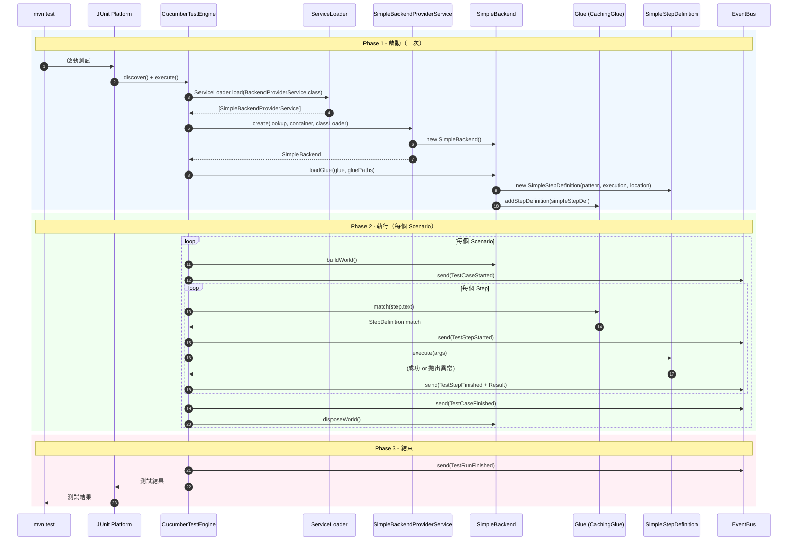

# Cucumber Backend SPI 實作指南

本文件基於 **Cucumber Backend SPI** 方案，完整列出需要實作的依賴介面、打包方案、載入順序。
先從**最簡單的 Cucumber 原生流程**開始，不包含自訂業務邏輯（isa.yml / InstructionType 等）。

> 研究備份：先前的純 JUnit 方案研究內容已備份至 `archive-pure-junit-research/`

---

## 目錄

1. [架構總覽](#1-架構總覽)
2. [需要實作的 Cucumber 依賴介面](#2-需要實作的-cucumber-依賴介面)
3. [介面完整定義（原始碼）](#3-介面完整定義原始碼)
4. [最小可運行實作](#4-最小可運行實作)
5. [SPI 註冊與打包方案](#5-spi-註冊與打包方案)
6. [Maven 依賴配置](#6-maven-依賴配置)
7. [載入順序與生命週期](#7-載入順序與生命週期)
8. [參考實作：JavaBackend](#8-參考實作javabackend)

---

## 1. 架構總覽

### 1.1 Cucumber Backend SPI 運作機制

```
mvn test
  ↓
JUnit / Cucumber JUnit Platform Engine
  ↓
Cucumber Runtime 初始化
  ↓
ServiceLoader.load(BackendProviderService.class)
  ↓ 讀取 META-INF/services/io.cucumber.core.backend.BackendProviderService
  ↓
BackendProviderService.create(lookup, container, classLoader)
  ↓
Backend.loadGlue(glue, gluePaths)
  ↓ glue.addStepDefinition(...)
  ↓ glue.addBeforeHook(...)
  ↓ glue.addAfterHook(...)
  ↓
Cucumber Runtime 開始執行 Scenarios
  ↓
對每個 Scenario：
  Backend.buildWorld()
  → 執行 Before Hooks
  → 匹配 & 執行 Steps (StepDefinition.execute)
  → 執行 After Hooks
  Backend.disposeWorld()
```

### 1.2 我們需要做什麼

只需要實作 **3 個核心介面** 即可讓 Cucumber 跑起來：

| 介面 | 用途 | 必要性 |
|------|------|--------|
| `BackendProviderService` | SPI 入口，被 ServiceLoader 發現 | **必要** |
| `Backend` | 載入 Glue、管理 Scenario 生命週期 | **必要** |
| `StepDefinition` | 定義 Step pattern 和執行邏輯 | **必要** |
| `Snippet` | 為 undefined steps 產生建議程式碼 | 選配（可返回簡單實作） |

其餘介面（`Glue`, `Lookup`, `Container`, `ParameterInfo` 等）由 Cucumber Runtime 提供實作或作為參數傳入，**不需要我們自己實作**。

---

## 2. 需要實作的 Cucumber 依賴介面

### 2.1 介面清單與關係

```
我們要實作的（3+2 個）:
────────────────────────
BackendProviderService      ← SPI 入口（1 個方法）
  └→ 產生 Backend

Backend                     ← 核心（4 個方法）
  └→ 在 loadGlue() 中建立 StepDefinition 並註冊

StepDefinition extends Located  ← Step 定義（3+2 個方法）
  └→ execute(), getPattern(), parameterInfos()
  └→ isDefinedAt(), getLocation()    ← 來自 Located

Snippet                     ← 選配（4 個方法）
  └→ 為 undefined step 產生 snippet

ParameterInfo               ← 選配（3 個方法）
  └→ 描述 StepDefinition 的參數類型

Cucumber 提供的（不需實作）:
────────────────────────
Glue                        ← Backend.loadGlue() 的參數，由 Runtime 注入
Lookup                      ← BackendProviderService.create() 的參數
Container                   ← BackendProviderService.create() 的參數
TestCaseState               ← HookDefinition.execute() 的參數
```

### 2.2 每個介面需要實作的方法

#### BackendProviderService（必要 - 1 個方法）

| 方法 | 簽名 | 說明 |
|------|------|------|
| `create` | `Backend create(Lookup, Container, Supplier<ClassLoader>)` | 建立 Backend 實例 |

#### Backend（必要 - 4 個方法）

| 方法 | 簽名 | 說明 |
|------|------|------|
| `loadGlue` | `void loadGlue(Glue glue, List<URI> gluePaths)` | 載入所有 Step/Hook，只呼叫一次 |
| `buildWorld` | `void buildWorld()` | 每個 Scenario 開始前呼叫 |
| `disposeWorld` | `void disposeWorld()` | 每個 Scenario 結束後呼叫 |
| `getSnippet` | `Snippet getSnippet()` | 返回 Snippet 生成器 |

#### StepDefinition extends Located（必要 - 5 個方法）

| 方法 | 簽名 | 來源 | 說明 |
|------|------|------|------|
| `execute` | `void execute(Object[] args)` | StepDefinition | 執行 Step 邏輯 |
| `getPattern` | `String getPattern()` | StepDefinition | Step 的匹配 pattern（regex 或 Cucumber Expression） |
| `parameterInfos` | `List<ParameterInfo> parameterInfos()` | StepDefinition | 參數類型資訊（可返回空 List） |
| `isDefinedAt` | `boolean isDefinedAt(StackTraceElement)` | Located | stack trace 過濾（可返回 false） |
| `getLocation` | `String getLocation()` | Located | Step 的原始碼位置描述 |

#### Snippet（選配 - 4 個方法 + 1 個 default）

| 方法 | 簽名 | 說明 |
|------|------|------|
| `template` | `MessageFormat template()` | Snippet 的 MessageFormat 模板 |
| `tableHint` | `String tableHint()` | DataTable 使用提示 |
| `arguments` | `String arguments(Map<String, Type>)` | 參數字串表示 |
| `escapePattern` | `String escapePattern(String)` | Pattern 跳脫處理 |
| `language` | `Optional<String> language()` | default 方法，可不覆寫 |

#### ParameterInfo（選配 - 3 個方法）

| 方法 | 簽名 | 說明 |
|------|------|------|
| `getType` | `Type getType()` | 參數的 Java 類型 |
| `isTransposed` | `boolean isTransposed()` | DataTable 是否轉置 |
| `getTypeResolver` | `TypeResolver getTypeResolver()` | 類型解析器 |

---

## 3. 介面完整定義（原始碼）

以下為 cucumber-core 中各介面的**原始定義**，來自 `io.cucumber.core.backend` 套件。

### 3.1 BackendProviderService

```java
package io.cucumber.core.backend;

import java.util.function.Supplier;

public interface BackendProviderService {
    Backend create(Lookup lookup, Container container, Supplier<ClassLoader> classLoader);
}
```

### 3.2 Backend

```java
package io.cucumber.core.backend;

import java.net.URI;
import java.util.List;

public interface Backend {

    /**
     * 在所有 Feature 執行前呼叫一次。
     * 在這裡透過 glue 註冊 StepDefinition 和 Hook。
     */
    void loadGlue(Glue glue, List<URI> gluePaths);

    /**
     * 每個 Scenario 開始前呼叫。
     * 可在此初始化 Scenario 範圍的狀態。
     */
    void buildWorld();

    /**
     * 每個 Scenario 結束後呼叫（在 After Hook 之後）。
     */
    void disposeWorld();

    /**
     * 返回 Snippet 生成器，用於 undefined steps。
     */
    Snippet getSnippet();
}
```

### 3.3 Glue（由 Cucumber 提供，我們使用它的方法）

```java
package io.cucumber.core.backend;

public interface Glue {
    void addStepDefinition(StepDefinition stepDefinition);
    void addBeforeHook(HookDefinition beforeHook);
    void addAfterHook(HookDefinition afterHook);
    void addBeforeStepHook(HookDefinition beforeStepHook);
    void addAfterStepHook(HookDefinition afterStepHook);
    void addBeforeAllHook(StaticHookDefinition beforeAllHook);
    void addAfterAllHook(StaticHookDefinition afterAllHook);
    void addParameterType(ParameterTypeDefinition parameterType);
    void addDataTableType(DataTableTypeDefinition dataTableType);
    void addDocStringType(DocStringTypeDefinition docStringType);
    void addDefaultParameterTransformer(DefaultParameterTransformerDefinition transformer);
    void addDefaultDataTableEntryTransformer(DefaultDataTableEntryTransformerDefinition transformer);
    void addDefaultDataTableCellTransformer(DefaultDataTableCellTransformerDefinition transformer);
}
```

### 3.4 StepDefinition

```java
package io.cucumber.core.backend;

import java.util.List;

public interface StepDefinition extends Located {

    /**
     * 執行 Step 邏輯。
     * @param args 從 Cucumber Expression / Regex 解析出的參數
     */
    void execute(Object[] args) throws CucumberBackendException, CucumberInvocationTargetException;

    /**
     * 參數資訊列表，不可返回 null。
     */
    List<ParameterInfo> parameterInfos();

    /**
     * Step 的匹配 pattern（Cucumber Expression 或 Regex）。
     */
    String getPattern();
}
```

### 3.5 Located

```java
package io.cucumber.core.backend;

import java.util.Optional;

public interface Located {

    /**
     * 是否定義在此 stack trace 元素。用於過濾 stack trace。
     */
    boolean isDefinedAt(StackTraceElement stackTraceElement);

    /**
     * Step 定義的原始碼位置。
     * 例如："com.example.MySteps.given_something(MySteps.java:15)"
     */
    String getLocation();

    default Optional<SourceReference> getSourceReference() {
        return Optional.empty();
    }
}
```

### 3.6 Snippet

```java
package io.cucumber.core.backend;

import java.lang.reflect.Type;
import java.text.MessageFormat;
import java.util.Map;
import java.util.Optional;

public interface Snippet {

    default Optional<String> language() {
        return Optional.empty();
    }

    /**
     * MessageFormat 模板，可用變數：
     *  {0} Step 關鍵字
     *  {1} escapePattern() 的值
     *  {2} 函數名
     *  {3} arguments() 的值
     *  {4} Regexp 提示
     *  {5} tableHint() 的值（若 step 有 table）
     */
    MessageFormat template();

    String tableHint();

    String arguments(Map<String, Type> arguments);

    String escapePattern(String pattern);
}
```

### 3.7 ParameterInfo

```java
package io.cucumber.core.backend;

import java.lang.reflect.Type;

public interface ParameterInfo {

    /**
     * 參數的 Java 類型。無法確定時返回 Object.class。
     */
    Type getType();

    /**
     * DataTable 是否應轉置。
     */
    boolean isTransposed();

    /**
     * 類型解析器，用於 DataTable 和 DocString 的轉換。
     */
    TypeResolver getTypeResolver();
}
```

### 3.8 TypeResolver

```java
package io.cucumber.core.backend;

import java.lang.reflect.Type;

public interface TypeResolver {
    Type resolve() throws RuntimeException;
}
```

### 3.9 Lookup

```java
package io.cucumber.core.backend;

public interface Lookup {
    <T> T getInstance(Class<T> glueClass);
}
```

### 3.10 Container

```java
package io.cucumber.core.backend;

public interface Container {
    boolean addClass(Class<?> glueClass);
}
```

### 3.11 HookDefinition

```java
package io.cucumber.core.backend;

import java.util.Optional;

public interface HookDefinition extends Located {
    void execute(TestCaseState state);
    String getTagExpression();
    int getOrder();

    default Optional<HookType> getHookType() {
        return Optional.empty();
    }

    enum HookType {
        BEFORE, AFTER, BEFORE_STEP, AFTER_STEP
    }
}
```

### 3.12 TestCaseState

```java
package io.cucumber.core.backend;

import java.net.URI;
import java.util.Collection;

public interface TestCaseState {
    Collection<String> getSourceTagNames();
    Status getStatus();
    boolean isFailed();
    void attach(byte[] data, String mediaType, String name);
    void attach(String data, String mediaType, String name);
    void log(String text);
    String getName();
    String getId();
    URI getUri();
    Integer getLine();
}
```

### 3.13 例外類別

```java
// CucumberBackendException - Backend 層面的錯誤（無法呼叫 glue code）
public class CucumberBackendException extends RuntimeException {
    public CucumberBackendException(String message) { super(message); }
    public CucumberBackendException(String message, Throwable cause) { super(message, cause); }
}

// CucumberInvocationTargetException - Step 內部拋出的錯誤
public final class CucumberInvocationTargetException extends RuntimeException {
    public CucumberInvocationTargetException(Located located, InvocationTargetException e) { ... }
    public Located getLocated() { ... }
    @Override public Throwable getCause() { return invocationTargetException.getCause(); }
}
```

---

## 4. 最小可運行實作

以下是**最精簡的實作**，只硬編碼一個 Step，目標是讓 Cucumber 完整跑起來。

### 4.1 SimpleBackendProviderService

```java
package com.example.backend;

import io.cucumber.core.backend.Backend;
import io.cucumber.core.backend.BackendProviderService;
import io.cucumber.core.backend.Container;
import io.cucumber.core.backend.Lookup;
import java.util.function.Supplier;

public class SimpleBackendProviderService implements BackendProviderService {

    @Override
    public Backend create(Lookup lookup, Container container,
                          Supplier<ClassLoader> classLoaderSupplier) {
        return new SimpleBackend();
    }
}
```

### 4.2 SimpleBackend

```java
package com.example.backend;

import io.cucumber.core.backend.Backend;
import io.cucumber.core.backend.Glue;
import io.cucumber.core.backend.Snippet;
import java.net.URI;
import java.util.List;

public class SimpleBackend implements Backend {

    @Override
    public void loadGlue(Glue glue, List<URI> gluePaths) {
        // 註冊一個最簡單的 StepDefinition
        glue.addStepDefinition(new SimpleStepDefinition(
            "a simple step",                      // Cucumber Expression pattern
            args -> System.out.println("Step executed!"),
            "SimpleBackend.loadGlue()"
        ));
    }

    @Override
    public void buildWorld() {
        // Scenario 開始前 - 目前空實作
    }

    @Override
    public void disposeWorld() {
        // Scenario 結束後 - 目前空實作
    }

    @Override
    public Snippet getSnippet() {
        return new SimpleSnippet();
    }
}
```

### 4.3 SimpleStepDefinition

```java
package com.example.backend;

import io.cucumber.core.backend.CucumberBackendException;
import io.cucumber.core.backend.CucumberInvocationTargetException;
import io.cucumber.core.backend.ParameterInfo;
import io.cucumber.core.backend.StepDefinition;
import java.lang.reflect.InvocationTargetException;
import java.util.Collections;
import java.util.List;
import java.util.function.Consumer;

public class SimpleStepDefinition implements StepDefinition {

    private final String pattern;
    private final Consumer<Object[]> execution;
    private final String location;

    public SimpleStepDefinition(String pattern,
                                Consumer<Object[]> execution,
                                String location) {
        this.pattern = pattern;
        this.execution = execution;
        this.location = location;
    }

    @Override
    public void execute(Object[] args)
            throws CucumberBackendException, CucumberInvocationTargetException {
        try {
            execution.accept(args);
        } catch (Exception e) {
            throw new CucumberInvocationTargetException(
                this, new InvocationTargetException(e));
        }
    }

    @Override
    public List<ParameterInfo> parameterInfos() {
        return Collections.emptyList();
    }

    @Override
    public String getPattern() {
        return pattern;
    }

    // --- Located 介面 ---

    @Override
    public boolean isDefinedAt(StackTraceElement stackTraceElement) {
        return false;
    }

    @Override
    public String getLocation() {
        return location;
    }
}
```

### 4.4 SimpleSnippet

```java
package com.example.backend;

import io.cucumber.core.backend.Snippet;
import java.lang.reflect.Type;
import java.text.MessageFormat;
import java.util.Map;

public class SimpleSnippet implements Snippet {

    @Override
    public MessageFormat template() {
        return new MessageFormat(
            "@{0}(\"{1}\")\n" +
            "public void {2}({3}) '{'\n" +
            "    // {4}\n" +
            "{5}" +
            "    throw new io.cucumber.java.PendingException();\n" +
            "'}'"
        );
    }

    @Override
    public String tableHint() {
        return "    // For automatic transformation, change DataTable to one of\n" +
               "    // E, List<E>, List<List<E>>, List<Map<K,V>>, Map<K,V> or\n" +
               "    // Map<K, List<V>>.\n";
    }

    @Override
    public String arguments(Map<String, Type> arguments) {
        StringBuilder sb = new StringBuilder();
        int i = 0;
        for (Map.Entry<String, Type> entry : arguments.entrySet()) {
            if (i > 0) sb.append(", ");
            String typeName = ((Class<?>) entry.getValue()).getSimpleName();
            sb.append(typeName).append(" ").append(entry.getKey());
            i++;
        }
        return sb.toString();
    }

    @Override
    public String escapePattern(String pattern) {
        return pattern.replace("\"", "\\\"");
    }
}
```

---

## 5. SPI 註冊與打包方案

### 5.1 SPI 註冊檔案

在專案中建立以下檔案：

```
src/main/resources/META-INF/services/io.cucumber.core.backend.BackendProviderService
```

檔案內容（只有一行，指向你的實作類別全名）：

```
com.example.backend.SimpleBackendProviderService
```

### 5.2 打包方案：直接放入現有專案

**目標：讓使用者只需在現有 Maven 專案的 pom.xml 加入依賴即可使用。**

#### 方案 A：獨立 JAR 模組（推薦）

```
specformula-backend/
├── pom.xml
└── src/main/
    ├── java/com/example/backend/
    │   ├── SimpleBackendProviderService.java
    │   ├── SimpleBackend.java
    │   ├── SimpleStepDefinition.java
    │   └── SimpleSnippet.java
    └── resources/META-INF/services/
        └── io.cucumber.core.backend.BackendProviderService
```

打包成 JAR 後，使用者在自己的專案 pom.xml 加入：

```xml
<dependency>
    <groupId>ai.specformula</groupId>
    <artifactId>specformula-backend</artifactId>
    <version>1.0.0-SNAPSHOT</version>
    <scope>test</scope>
</dependency>
```

ServiceLoader 會自動從 classpath 的 `META-INF/services/` 發現並載入。

#### 方案 B：直接放入現有專案（零額外依賴）

如果不想拆獨立模組，直接將以上 Java 類別和 SPI 檔案放入現有專案即可：

```
your-existing-project/
├── pom.xml                          ← 加入 cucumber 依賴
└── src/
    ├── main/java/                   ← 或放在 test/java/ 也可以
    │   └── com/example/backend/
    │       ├── SimpleBackendProviderService.java
    │       ├── SimpleBackend.java
    │       ├── SimpleStepDefinition.java
    │       └── SimpleSnippet.java
    ├── main/resources/              ← 或 test/resources/
    │   └── META-INF/services/
    │       └── io.cucumber.core.backend.BackendProviderService
    └── test/resources/features/
        └── sample.feature
```

> **注意**：SPI 檔案和對應的 class 必須在同一個 classpath 下。
> 如果 class 放在 `src/test/java`，SPI 檔案就放 `src/test/resources`。

### 5.3 與 cucumber-java 共存

如果專案同時有 `cucumber-java` 依賴，**SPI 會載入所有 BackendProviderService**。
兩個 Backend 會共存，各自註冊自己的 StepDefinition。

如果只想用自訂 Backend，**不要引入 cucumber-java 依賴**。

---

## 6. Maven 依賴配置

### 6.1 最小依賴（使用自訂 Backend，不需要 cucumber-java）

```xml
<properties>
    <cucumber.version>7.15.0</cucumber.version>
    <junit.version>5.10.2</junit.version>
    <junit-platform.version>1.10.2</junit-platform.version>
</properties>

<dependencyManagement>
    <dependencies>
        <dependency>
            <groupId>io.cucumber</groupId>
            <artifactId>cucumber-bom</artifactId>
            <version>${cucumber.version}</version>
            <type>pom</type>
            <scope>import</scope>
        </dependency>
        <dependency>
            <groupId>org.junit</groupId>
            <artifactId>junit-bom</artifactId>
            <version>${junit.version}</version>
            <type>pom</type>
            <scope>import</scope>
        </dependency>
    </dependencies>
</dependencyManagement>

<dependencies>
    <!-- ==================== -->
    <!-- Cucumber 核心         -->
    <!-- ==================== -->

    <!-- 包含 Backend SPI 介面、FeatureParser、EventBus、Formatters -->
    <dependency>
        <groupId>io.cucumber</groupId>
        <artifactId>cucumber-core</artifactId>
        <scope>test</scope>
    </dependency>

    <!-- JUnit Platform Engine - 讓 Cucumber 透過 JUnit 5 執行 -->
    <dependency>
        <groupId>io.cucumber</groupId>
        <artifactId>cucumber-junit-platform-engine</artifactId>
        <scope>test</scope>
    </dependency>

    <!-- ==================== -->
    <!-- JUnit 5              -->
    <!-- ==================== -->

    <dependency>
        <groupId>org.junit.jupiter</groupId>
        <artifactId>junit-jupiter</artifactId>
        <scope>test</scope>
    </dependency>

    <dependency>
        <groupId>org.junit.platform</groupId>
        <artifactId>junit-platform-suite</artifactId>
        <scope>test</scope>
    </dependency>

    <!-- ==================== -->
    <!-- 不需要 cucumber-java  -->
    <!-- ==================== -->
    <!-- cucumber-java 提供 @Given/@When/@Then 註解式 Backend -->
    <!-- 我們自訂 Backend，所以不需要它 -->
</dependencies>

<build>
    <plugins>
        <plugin>
            <groupId>org.apache.maven.plugins</groupId>
            <artifactId>maven-surefire-plugin</artifactId>
            <version>3.2.5</version>
        </plugin>
    </plugins>
</build>
```

### 6.2 依賴樹說明

```
自訂 Backend 專案的依賴樹:

io.cucumber:cucumber-core
├── io.cucumber:cucumber-gherkin           ← Gherkin 介面 (Feature, Pickle, Step)
│   └── io.cucumber:cucumber-plugin        ← Event/Plugin 介面
├── io.cucumber:cucumber-gherkin-messages  ← Gherkin 解析實作
├── io.cucumber:cucumber-expressions       ← Expression 匹配引擎
├── io.cucumber:datatable                  ← DataTable 處理
├── io.cucumber:html-formatter             ← HTML 報表
├── io.cucumber:tag-expressions            ← Tag 過濾
└── io.cucumber:messages                   ← Cucumber Messages

io.cucumber:cucumber-junit-platform-engine ← 讓 mvn test 執行 Cucumber
├── io.cucumber:cucumber-core
└── org.junit.platform:junit-platform-engine

org.junit.jupiter:junit-jupiter            ← JUnit 5
org.junit.platform:junit-platform-suite    ← @Suite 支援
```

### 6.3 不需要的依賴

| 依賴 | 原因 |
|------|------|
| `cucumber-java` | 提供 `@Given/@When/@Then` + `JavaBackend`，我們自訂 Backend 替代 |
| `cucumber-java8` | Lambda 風格的 Step 定義，同上 |
| `cucumber-spring` | Spring DI 整合，後續可視需求加入 |
| `cucumber-picocontainer` | PicoContainer DI，不使用 |
| `cucumber-guice` | Guice DI，不使用 |

---

## 7. 載入順序與生命週期

### 7.1 完整載入順序

```
┌─────────────────────────────────────────────────────────────────────────┐
│  Phase 1: 啟動（整個 Test Suite 只執行一次）                              │
├─────────────────────────────────────────────────────────────────────────┤
│                                                                         │
│  1. mvn test 啟動 Surefire Plugin                                       │
│  2. JUnit Platform 發現 CucumberTestEngine                              │
│  3. CucumberTestEngine 建立 Cucumber Runtime                            │
│  4. Runtime 透過 ServiceLoader 載入所有 BackendProviderService           │
│     └→ ServiceLoader.load(BackendProviderService.class)                 │
│     └→ 讀取 META-INF/services/io.cucumber.core.backend.                │
│              BackendProviderService                                      │
│  5. 呼叫每個 BackendProviderService.create(lookup, container, classLoader)│
│     └→ 返回 Backend 實例                                                │
│  6. 呼叫每個 Backend.loadGlue(glue, gluePaths)                          │
│     └→ 在此註冊所有 StepDefinition 和 Hook                              │
│     └→ glue.addStepDefinition(...)                                      │
│     └→ glue.addBeforeHook(...)                                          │
│     └→ glue.addAfterHook(...)                                           │
│  7. Cucumber 解析所有 .feature 檔案                                      │
│  8. Cucumber 編譯所有 StepDefinition 的 Expression                       │
│                                                                         │
└─────────────────────────────────────────────────────────────────────────┘
                                    ↓
┌─────────────────────────────────────────────────────────────────────────┐
│  Phase 2: 執行（每個 Scenario 重複）                                      │
├─────────────────────────────────────────────────────────────────────────┤
│                                                                         │
│  對每個 Scenario:                                                        │
│                                                                         │
│  1. Backend.buildWorld()                                                │
│     └→ 初始化 Scenario-scoped 狀態                                       │
│                                                                         │
│  2. 執行 BeforeAll Hooks（只在第一個 Scenario 前）                        │
│  3. 執行 Before Hooks（每個 Scenario 前）                                 │
│                                                                         │
│  4. 對每個 Step:                                                         │
│     a. Cucumber 用 CachingGlue 匹配 step text → StepDefinition          │
│     b. Cucumber 從 Expression 解析參數                                    │
│     c. 呼叫 StepDefinition.execute(args)                                 │
│     d. 記錄執行結果（PASSED / FAILED / SKIPPED）                          │
│                                                                         │
│  5. 執行 After Hooks（每個 Scenario 後）                                  │
│  6. 執行 AfterAll Hooks（只在最後一個 Scenario 後）                        │
│                                                                         │
│  7. Backend.disposeWorld()                                               │
│     └→ 清理 Scenario-scoped 狀態                                         │
│                                                                         │
└─────────────────────────────────────────────────────────────────────────┘
                                    ↓
┌─────────────────────────────────────────────────────────────────────────┐
│  Phase 3: 結束                                                           │
├─────────────────────────────────────────────────────────────────────────┤
│                                                                         │
│  1. EventBus 發送 TestRunFinished                                        │
│  2. Formatters 產生報表（HTML / JSON）                                    │
│  3. 測試結果回傳 JUnit Platform → Surefire → Maven                       │
│                                                                         │
└─────────────────────────────────────────────────────────────────────────┘
```

### 7.2 循序圖



### 7.3 關鍵方法呼叫次數

| 方法 | 呼叫時機 | 呼叫次數 |
|------|----------|----------|
| `BackendProviderService.create()` | Runtime 初始化 | **1 次** |
| `Backend.loadGlue()` | Runtime 初始化 | **1 次** |
| `Backend.buildWorld()` | 每個 Scenario 開始前 | **N 次**（N = Scenario 數量） |
| `StepDefinition.execute()` | 每個 Step 執行時 | **M 次**（M = 總 Step 數量） |
| `Backend.disposeWorld()` | 每個 Scenario 結束後 | **N 次** |
| `Backend.getSnippet()` | 遇到 undefined step 時 | 視情況 |

---

## 8. 參考實作：JavaBackend

Cucumber 官方的 `cucumber-java` 模組就是一個 Backend SPI 的完整實作，供參考。

### 8.1 JavaBackendProviderService

```java
// io.cucumber.java.JavaBackendProviderService
public final class JavaBackendProviderService implements BackendProviderService {
    @Override
    public Backend create(Lookup lookup, Container container,
                          Supplier<ClassLoader> classLoaderSupplier) {
        return new JavaBackend(lookup, container, classLoaderSupplier);
    }
}
```

### 8.2 JavaBackend（核心邏輯簡化）

```java
// io.cucumber.java.JavaBackend
final class JavaBackend implements Backend {
    private final Lookup lookup;
    private final Container container;
    private final ClasspathScanner classFinder;

    JavaBackend(Lookup lookup, Container container,
                Supplier<ClassLoader> classLoaderSupplier) {
        this.lookup = lookup;
        this.container = container;
        this.classFinder = new ClasspathScanner(classLoaderSupplier);
    }

    @Override
    public void loadGlue(Glue glue, List<URI> gluePaths) {
        GlueAdaptor glueAdaptor = new GlueAdaptor(lookup, glue);

        gluePaths.stream()
            .filter(path -> "classpath".equals(path.getScheme()))
            .map(ClasspathSupport::packageName)
            .map(classFinder::scanForClassesInPackage)
            .flatMap(Collection::stream)
            .distinct()
            .forEach(aGlueClass -> scan(aGlueClass, (method, annotation) -> {
                container.addClass(method.getDeclaringClass());
                glueAdaptor.addDefinition(method, annotation);
            }));
    }

    @Override
    public void buildWorld() { /* No-op */ }

    @Override
    public void disposeWorld() { /* No-op */ }

    @Override
    public Snippet getSnippet() { return new JavaSnippet(); }
}
```

**重點觀察：**
- `loadGlue()` 掃描 classpath 上的 Java 類別，找到 `@Given/@When/@Then` 註解的方法
- 透過 `glueAdaptor.addDefinition()` 將每個方法包裝成 `StepDefinition` 並註冊到 `Glue`
- `buildWorld()` 和 `disposeWorld()` 是空實作（由 ObjectFactory 管理生命週期）

### 8.3 SPI 註冊檔

```
# cucumber-java/src/main/resources/META-INF/services/
#   io.cucumber.core.backend.BackendProviderService
io.cucumber.java.JavaBackendProviderService
```

---

## 附錄 A：測試入口類別

### 使用 JUnit Platform Suite

```java
package com.example;

import org.junit.platform.suite.api.ConfigurationParameter;
import org.junit.platform.suite.api.IncludeEngines;
import org.junit.platform.suite.api.SelectPackages;
import org.junit.platform.suite.api.Suite;

import static io.cucumber.junit.platform.engine.Constants.*;

@Suite
@IncludeEngines("cucumber")
@SelectPackages("com.example")
@ConfigurationParameter(key = FEATURES_PROPERTY_NAME, value = "src/test/resources/features")
@ConfigurationParameter(key = GLUE_PROPERTY_NAME, value = "com.example.backend")
@ConfigurationParameter(key = PLUGIN_PROPERTY_NAME, value = "pretty, html:target/cucumber-reports/report.html")
public class RunCucumberTest {
}
```

### 使用 cucumber.properties

```properties
# src/test/resources/cucumber.properties
cucumber.features=src/test/resources/features
cucumber.glue=com.example.backend
cucumber.plugin=pretty, html:target/cucumber-reports/report.html
```

## 附錄 B：測試用 Feature 檔案

```gherkin
# src/test/resources/features/sample.feature
Feature: 最簡單的測試

  Scenario: 執行一個 step
    Given a simple step
```

---

## 附錄 C：專案結構總覽

```
your-project/
├── pom.xml
└── src/
    ├── main/java/
    │   └── com/example/backend/
    │       ├── SimpleBackendProviderService.java   ← 實作 BackendProviderService
    │       ├── SimpleBackend.java                  ← 實作 Backend
    │       ├── SimpleStepDefinition.java           ← 實作 StepDefinition
    │       └── SimpleSnippet.java                  ← 實作 Snippet
    ├── main/resources/
    │   └── META-INF/services/
    │       └── io.cucumber.core.backend.BackendProviderService
    └── test/
        ├── java/com/example/
        │   └── RunCucumberTest.java                ← JUnit Suite 入口
        └── resources/
            ├── features/
            │   └── sample.feature                  ← 測試 Feature
            └── cucumber.properties                 ← Cucumber 設定
```

---

*文件版本: 1.0*
*建立日期: 2025-01*
*方案: Cucumber Backend SPI*
